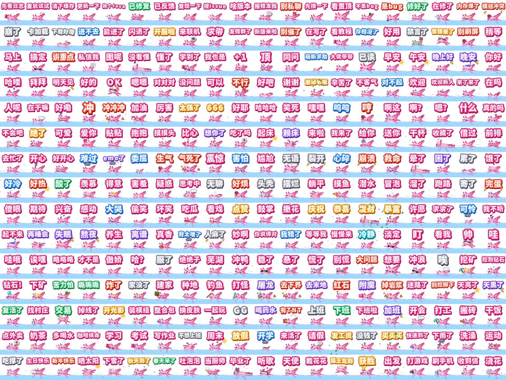

# AxoStickers · 美西螈表情包

Axolotl Launcher 的美西螈动画表情包：300 张 + 4 张初代 + 水龙卷特别篇，以及生成它们的引擎和 Claude skill。



- 400×400 GIF，15 fps，无缝循环，第一帧就是字全出来的封面，单张 ≤ 1 MB
- 同一个体素美西螈、同一套粉色立体字和水面；75 种动作，同一个动作最多出现 7 次
- 五个分类：群里答疑 55 · 日常回复 66 · 情绪 97 · 我的世界 34 · 生活 48
- 一次性下载：见 [Releases](https://github.com/Axolotl-Launcher/AxoStickers/releases)
- 网站：<https://axolotl-launcher.github.io/AxoStickers/>：在线挑、逐帧看、单张下载，还有创意工坊（在浏览器里做动图、改组件代码，导出 GIF 或者分享链接）

## 目录

| 路径 | 内容 |
|---|---|
| `out/NNN_文字.gif` | 300 张表情（网页引擎按 `out/projects/` 的工程出的，一圈 4 秒 60 帧） |
| `out/projects/NNN.json` | 300 张的工程（`engine/projects.py` 按 `specs.py` 的配方翻新生成），图鉴里「在工坊里改一改」打开它 |
| `out/_封面/` | 每张的静态封面 PNG |
| `out/初代_*.gif` | 初代表情包工具包 examples/ 里的 4 张原图（发日志 / 请截图 / 看文档 / 看群公告），不是这个引擎出的；照着原图的脚本在网站编辑器里拼了一份工程（`workshop/projects/og-*.json`），图鉴里点开就能「在工坊里改一改」 |
| `out/水龙卷_*.gif` | 水龙卷特别篇（无字 / 我没事 / 转晕了） |
| `out/stickers.json` | 清单：文字、分类、动作、表情、特效、道具、配色、文件路径 |
| `engine/` | 引擎：`specs.py` 一行一张，`build.py` 批量出图，`sheet.py` 检查拼图，`tornado.py` 水龙卷 |
| `kit/` | 美西螈模型与渲染器（`rig.py` / `rig2.py` / `face_cam.py`）、思源黑体 |
| `skill/axolotl-sticker/` | 给 Claude Code 用的 skill：让 Claude 按这套风格做新表情 |
| `site/` | 网站：图鉴（悬停就动、点开逐帧看）+ 创意工坊编辑器（Vite，three.js 版引擎，组件化） |
| `site/src/components/` | 内置组件：75 个动作、49 个特效、13 个文字动画、皮肤，每个一个 `.axo.js` 文件 |
| `workshop/components/` | 工坊里的组件（比如水龙卷、果冻字），写法见 [workshop/components/README.md](workshop/components/README.md) |
| `workshop/` | 创意工坊：`index.json` 作品清单、作品的图和工程、`tools/workshop.py` 校验 / 收图脚本、`issue-form/` 停用中的投稿表单 |
| `.github/` | 出图、数点赞、部署网站的工作流 |

## 自己出图

300 张现在是网页引擎出的（和创意工坊编辑器同一个引擎），照初代那 4 张的路子翻新过：字一个个蹦出来、群里答疑那些从水里浮上来再潜回去、
一下子的特效等字落定了再出、有一批按意思加了提示条 / 禁止标志 / 纸飞机 / 截图框。规则和按意思加的那批都在 `engine/projects.py` 里。

```
python engine/projects.py                # 按 specs.py 生成工程 -> out/projects/（也可以只生成几张：python engine/projects.py 12,40-45）
cd site && npm run build                 # 出图用的是构建好的网站（dist/sandbox.html）
node tools/render_stickers.mjs --channel msedge          # 出全部：out/NNN_文字.gif + out/_封面/；一批 20 张歇 20 秒。只出几张：后面加 12,40-45
cd .. && python engine/manifest.py       # 更新 out/stickers.json（会带上工程路径和做法摘要）
```

`--channel msedge` 用本机的 Edge（也可以 `chrome`）；不写就用 Playwright 自己下的 Chromium，没显卡的机器加 `--soft`。

翻新前的版本是 Python 引擎出的（一圈 3.2 秒 48 帧），要对照的话用 Python 3.9+、`pip install numpy pillow`、ffmpeg，纯 CPU：
`python engine/build.py 12 --force` 会把那张盖回老版本，`python engine/sheet.py 1-30` 出检查用拼图（-> ref/）。

水龙卷要用几张原版 Minecraft 材质（铁头盔、海龟壳、美西螈桶、TNT），仓库里不带。先从你自己电脑上的客户端里取出来：

```
python engine/fetch_mc.py                # 自动找 .minecraft/versions 里的 1.21.2+ 客户端；也可以把 jar 路径传进去
python engine/tornado.py 我没事           # 文字写 - 出无字版
```

## 加一张新表情

在 `engine/specs.py` 对应分类的末尾加一行：

```python
S('摸鱼', 'flagwave', 'happy', [], hold='fish', s=0.7)
#  文字    动作        表情     特效  道具
```

动作、表情、特效、道具、配色、文字动画的完整列表见 [skill/axolotl-sticker/SKILL.md](skill/axolotl-sticker/SKILL.md)。
然后 `python engine/projects.py` 生成它的工程（想按意思加提示条、纸飞机这些，在 `projects.py` 的 `SYS` / `OVERRIDES` 里加），再按上面出图。

## 用 skill 让 Claude 做

把 `skill/axolotl-sticker/` 复制到 `~/.claude/skills/`（或项目的 `.claude/skills/`），在这个仓库里对 Claude Code 说"做一张『下班了』的美西螈表情"就行。

## 网站和创意工坊

网站是纯静态的，部署在 GitHub Pages；创意工坊用 GitHub 当后台。

图鉴里的图能直接从网页拖进 QQ（是动图），拖到桌面存成中文名。QQ 会自己去下拖进去的图片地址，地址里有中文就失败，所以网站上表情 GIF 换成了英文地址 `gif/001.gif`，初代和水龙卷用清单里的 `slug`：`gif/og-send-log.gif`、`gif/tornado-1.gif`（`site/tools/assemble.py` 的 `site_gifs`，开发服务器同一套规则），中文名只当文件名用。

**编辑器**像个小 GIF 工具：左边素材栏（模板、文字、动作、表情、特效、道具、帽子、皮肤、模型、工坊，每样都能收藏、只看收藏），中间实时预览（播放 / 暂停 / 逐帧 / 洋葱皮 / 换底色 / 画质），下面时间轴（每个图层一条，可以拖时间段、叠多个动作），右边属性面板，还有撤销重做、分享链接、导出 GIF / 逐帧 PNG / 微信表情尺寸。手机和平板上舞台在上、底部四个页签切换素材 / 属性 / 时间轴 / 代码。

**一切都是组件。** 动作、特效、文字动画、道具、帽子、表情、皮肤、整帧场景都是一段 `component({...})` 代码：

- 「代码」面板里能直接改任何一个组件（包括内置的），改完马上在预览里看到，出错会标到行；可以另存为自己的组件、下载成 `.axo.js`。
- 「工坊」默认列出仓库 `workshop/components/` 里的全部组件。点「添加」就下载到这台设备浏览器的组件库（IndexedDB），之后在它那一类里就能用：下载的文字动画出现在「文字」、特效在「特效」……只有水龙卷这种多种效果拼起来、代码很多的整帧场景才算「组件」，在「工坊 · 我的组件库」里点「用上」。「删除」是真的从浏览器里删掉，当前工程里用到它的地方会一起拿掉。
- 别人做的组件：把 `.axo.js` 拖进编辑器也能载入组件库；自己写的可以「下载」成 `.axo.js` 发给别人。
- 皮肤是给模型重新上色的组件。模型也在工坊里（`workshop/models/`，比如 Logo 版）：添加后存进本机的库，分享出去别人也能打开；也能拖进自己的 `.glb` / `.gltf`（自动体素化，存在本机的库里，只在本机用）。
- 模型能整体挪位置、缩放、旋转、左右镜像（直接在预览上拖、滚轮缩放，或者在「模型」里拖滑块）；帽子能调「戴在哪」；字色除了内置几种还能自己挑；背景可以是上下渐变。
- 「我的工程」把工程存在这台设备的浏览器里（带小图），随时打开接着改；导出除了 GIF 还有视频（MP4 / WebM）。进入创意工坊后网站顶栏自动收起来，鼠标移到最上沿再出来。
- 文字可以换字体：默认的 Axo 黑体、几种系统字体，或者导入 `.ttf` / `.otf` / `.woff2`（存在本机的库里）。
- 分享有两种链接：完整链接（工程整个装在链接里，一直有效）和 1 分钟短链接（工程在浏览器里用随机密钥加密，只把密文交给公开中转站 [ntfy.sh](https://ntfy.sh) 存一下；密钥只在链接 `#` 后面，1 分钟后打不开）。
- 组件代码只在 `<iframe sandbox="allow-scripts">` 里跑（`site/sandbox.html`，不透明来源，CSP 禁止联网），碰不到网站的页面和存储；死循环有保险，卡住了会自动重开。

**工坊投稿暂未开放。** 已有的工坊作品照常能看、点 👍；每一张都能点「在工坊里改一改」，把整个工程（连带它的组件代码）载进编辑器接着改。

<details>
<summary>维护者：重新开放投稿</summary>

1. `site/src/flags.js` 的 `CONTRIBUTE` 改成 `true`：网站上的「发布到工坊」「提交到工坊」和相关说明（含 `llms.txt`）回来。
2. 把 `workshop/issue-form/workshop.yml` 挪回 `.github/ISSUE_TEMPLATE/`：GitHub 的 New issue 页面上出现「发布到创意工坊」。
3. 仓库变量 `WORKSHOP_OPEN` 设成 `true`（Settings → Secrets and variables → Actions → Variables）：`工坊 · 出图` 的 `render` / `publish` 才会跑，没设就跳过所有 `[工坊]` issue。
4. 撤下（给 issue 打 `rejected` 标签）和 `工坊 · 数点赞` 不受开关影响，一直能用。

流程：`render` 没有任何权限，校验工程（结构、大小、文字、授权、查重、每人每天 5 张）、构建网站，在断网的容器里用无头 Chromium 打开同一个沙盒页面出图（`site/tools/render.mjs`）；`publish` 从事件里重新读、重新校验工程，GIF 用 Pillow 解码检查、重新编码，把 GIF、封面、工程（`workshop/projects/N.json`）和 `workshop/index.json` 提交到 main，回复并关掉 issue，触发网站部署。点赞是 issue 上的 👍，每 6 小时数一次。
</details>

**给 AI 助手和自动化工具用：** 能执行 JavaScript 的工具直接调 `window.axo`（`await axo.studio()` 打开编辑器，`axo.layers.add(...)`、`axo.workshop.add(...)`、`axo.export()` …），只能点按钮的工具每个控件都有中文名字和稳定的 `data-ax` 操作名，读不到画布就看 `[data-ax="status"]` 那一句描述。页面里不用浏览器原生的 confirm / prompt。完整说明在 [site/public/llms.txt](site/public/llms.txt)（网站根目录的 `llms.txt`）。

**性能分档**（`site/src/perf.js`）：有显卡加速的电脑高画质；手机 / 平板和没有显卡加速（浏览器关了硬件加速、只有软件渲染）的设备预览时三维部分 1 倍（少画 3/4 的像素），导出总是 2 倍超采样；没有显卡加速时首页不跑实时渲染、悬停视频少放几个。预览和 GIF 一样一帧一帧地换，每帧第一次画完就缓存成位图，看不见舞台或者正在导出时不画。舞台上的「画质」可以手动选流畅 / 清晰。

**引擎在 Worker 里跑**：沙盒页面（`sandbox.js`）把引擎（`sandbox-core.js`：组件代码、三维渲染、GIF 编码）放进它开的 Worker（`sandbox-worker.js`，OffscreenCanvas），编辑器界面所在的线程只管界面；Worker 跑不起来就在沙盒页面里跑同一份引擎（`#/editor?worker=0` 可以强制这样，对比用）。Worker 和沙盒页面一样是不透明来源、继承同样的 CSP，开完以后再封上 `worker-src 'none'`，组件代码开不了新的 Worker。

**字体**：界面全用系统字体；表情同款的 Axo 黑体按字切成一百多个 woff2，只在画布上的表情字、首页标题和 Logo 字上用，用到哪些字才下哪些切片。画字、导出前都等这些字真的能用（切片没下下来就报错、不导出，不会悄悄换成系统字体）。

**量一下**：`node site/tools/perf.mjs <拼好的网站目录> --base /AxoStickers/ --rate 6 [--sw] [--page]`：打开编辑器下了多少字体和脚本，手机视口 + CPU 降速 6 倍时预览帧率、主线程长任务（播放、拖滑块）、导出 400px GIF 的用时和界面卡顿。

网页引擎（`site/src/engine/`）的模型面片、表情、道具和图标由 `site/tools/export_engine.py` 从 Python 引擎导出，动作、特效、文字动画逐行移植成了组件（`site/tools/split_motions.py`），和 Python 引擎逐帧对照（`dev.html`）。

本地跑网站（Node 20+，另外 `pip install numpy pillow fonttools brotli`，悬停预览视频要 ffmpeg）：

```
cd site
npm ci
npm run data     # 导出引擎数据 + 把思源黑体切成网页字体（生成到 site/src/gen/，不进 git）
npm run dev      # http://localhost:5173 ；dev.html 是和 Python 引擎逐帧对照的页面
npm run build && node tools/render.mjs dist project.json test.gif   # 和工坊一样在无头浏览器里出图（要先 npx playwright install chromium）
```

部署需要在仓库 Settings → Pages 里把来源设成 GitHub Actions。

## 授权

代码和表情 GPL-3.0-only，模型来自 [Axolotl Launcher](https://github.com/Axolotl-Launcher/Axolotl)，字体是思源黑体（SIL OFL 1.1）。不含任何 Minecraft 游戏文件；Minecraft 是 Mojang Synergies AB 的商标，本项目与 Mojang 无关。详见 [COPYING.md](COPYING.md)。
